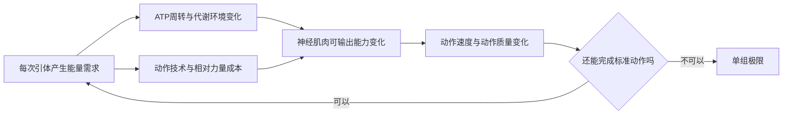
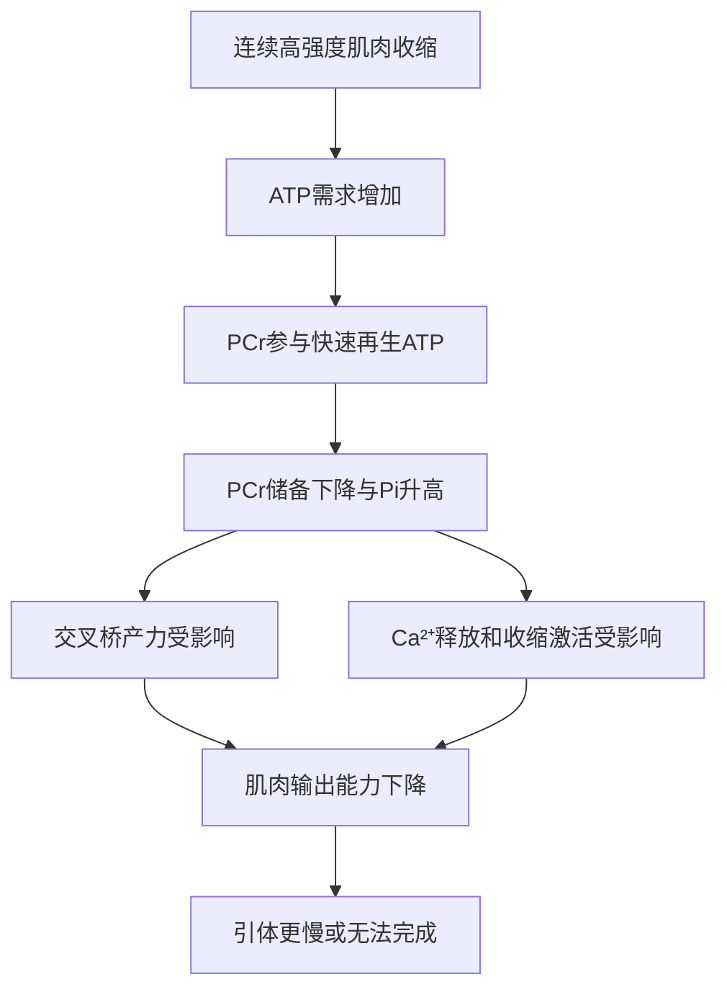
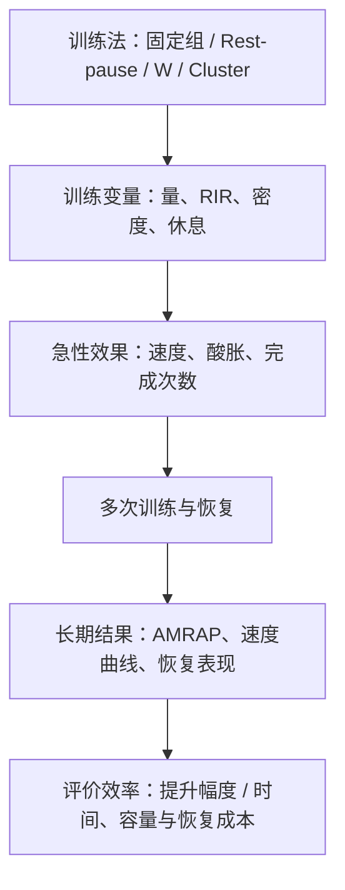

# 健身理论：引体向上专项耐力的生理机制与训练方法

> **研究目标**：理解哪些因素限制单组最大标准引体次数（AMRAP），从生理机制推导训练方法，并比较其训练效率。  
> **整理日期**：2026-10-14  
> **适用情境**：以纯自重、严格标准的连续引体次数为主要表现指标；重点是机制研究，不预设固定训练计划。  
> **阅读约定**：**【研究】**表示有文献直接或间接支持；**【推断】**表示有生理逻辑但缺少对应引体专项验证；**【观察指标】**表示方便个人记录，尚未成为经过验证的独立生理测试。

[TOC]

---

## 1. 从目标开始：到底要提高什么？

### 1.1 核心表现指标

**单组最大连续引体次数**：在相同体重附近、同一握法、动作幅度、节奏规则和判定标准下，一次连续完成的最大合格次数。

这一任务近似于**固定绝对负荷的局部肌耐力测试**：体重在一次测试中基本固定，但如果训练前后体重变化，负荷也会变化，需要单独记录。研究通常区分：

- **绝对肌耐力（absolute muscular endurance）**：前后测试保持同一负荷。
- **相对肌耐力（relative muscular endurance）**：使用受试者当前最大力量的一定百分比作为测试负荷。

两种测试对训练效果的判断可能不同，不能将它们的研究结果直接互换。【研究：R5、R6】

### 1.2 六个影响最大次数的核心因素

1. **相对力量储备**：自身体重占可动员最大拉力的比例。力量储备越大，理论上每次动作的相对负担越低。
2. **动作经济性**：完成每个合格动作的额外摆动、无效用力、节奏和运动协调成本。
3. **局部能量供给与代谢稳态**：ATP再生、磷酸肌酸（PCr）变化、无机磷酸盐（Pi）等因素。
4. **连续收缩期间的输出维持**：做得越多，产力与速度通常越容易下降，最终无法完成标准动作。
5. **不完全恢复后的再次输出**：休息20秒或2分钟后，还能恢复多少重复输出能力。
6. **测试条件**：体重、握距、握法、动作幅度、动作节奏、睡眠和训练前疲劳。

下面的式子是帮助理解的**简化模型**，并非可直接测量的肌肉方程：

> 只要当前可产生的有效拉力足以完成规定动作，就能继续；随着疲劳增加，当有效输出无法满足动作要求时，测试结束。



> **关键限制**：这张图表达因果关系的研究方向；一次训练中的动作掉速，不足以独立证明是哪一种细胞机制在主导。

---

## 2. 肌肉怎样供能：ATP、PCr、Pi

### 2.1 ATP是直接能量货币

肌球蛋白产生力量的循环依赖ATP水解。为便于理解，可以简写成：

$$
\mathrm{ATP+H_2O\rightarrow ADP+P_i}+\text{能量}
$$

- **ATP**：三磷酸腺苷，是收缩活动直接利用的能量货币。
- **ADP**：二磷酸腺苷，ATP水解后的产物之一。
- **Pi**：无机磷酸盐，参与正常能量代谢。

人体会不断通过不同途径再生ATP。持续引体期间，**PCr系统、糖酵解与氧化磷酸化同时参与**，各途径贡献随动作持续时间、强度、肌肉状态而变化。不能把每个重复次数硬性归属于单一供能系统。

### 2.2 磷酸肌酸（PCr）用于快速再生ATP

在肌酸激酶参与下，反应可以表示为：

$$
\mathrm{PCr+ADP+H^+\rightleftharpoons ATP+Cr}
$$

**理解**：PCr相当于肌细胞的快速能量缓冲储备，在ATP需求突然升高时，帮助维持ATP供应。

- 一组高强度引体中，PCr储备可能下降。
- 停止收缩、恢复供氧后，PCr逐渐重新合成。
- **20秒短休可以产生部分恢复**，但恢复比例取决于先前消耗量、收缩类型、血流与个体差异；不能把它写成一个固定百分比。【研究：R2】

### 2.3 Pi为何可能使肌肉变弱？

连续高强度收缩时，肌细胞内Pi可能升高；研究提出两条重要途径：

1. **影响肌丝产力**：改变肌动蛋白—肌球蛋白交叉桥工作状态，使每次收缩可输出的力量下降。
2. **影响兴奋—收缩耦联**：影响肌浆网Ca²⁺的释放或相关调控，使肌肉激活和产力受到限制。

Pi是外周肌肉疲劳的重要候选机制之一。离子变化、氧化还原状态、神经驱动和局部血流等也同时参与。【研究：R1、R3】



### 2.4 “上酸”究竟是不是乳酸堆积？

**灼热、泵感、酸胀可以记录，但不能直接当成乳酸浓度测量。**

- 乳酸（lactate）是代谢产物，也可以被组织利用作为能量底物。
- 高强度运动中出现的酸碱环境变化、感觉神经信号、局部血流与代谢变化，可能与灼热感同时出现。
- Pi、H⁺、离子扰动等因素共同影响疲劳。将“乳酸本身导致酸痛并造成力竭”作为唯一解释，会误导机制分析。【研究：R1、R4】

**适合个人研究的叫法**：

- 主观“上酸”：**首次明显灼热／酸胀节点**。
- 产力降低：**动作速度下降或标准动作失败**。
- 两者可能相关，**没有必须同时出现的规律**。

---

## 3. 疲劳分类：哪些是原因，哪些是表现？

原笔记使用“机械疲劳、代谢疲劳、神经控制疲劳”三个术语。为了便于严谨分析，可按下表理解：

| 笔记常用说法 | 更精确的解释 | 可观察现象 | 无法仅靠该现象确认的事情 |
|---|---|---|---|
| 机械疲劳 | **神经肌肉输出下降**：力量、速度、功率等表现降低 | 相同动作越来越慢、规定高度拉不上去 | 不能从掉速单独区分代谢因素和中枢因素 |
| 代谢疲劳 | **代谢相关外周疲劳**：Pi、PCr、离子和供能环境变化影响收缩功能 | 灼热、沉重、短休后表现部分恢复 | 酸胀不等于血乳酸或肌细胞Pi的直接读数 |
| 神经控制疲劳 | **中枢驱动与运动控制相关变化**：运动单位驱动、协调与姿势控制需求改变 | 节奏混乱、身体晃动、代偿增多 | 动作变形不能直接诊断“中枢疲劳” |

**【研究】**疲劳是多因素系统性现象。**【观察】**动作速度可以用来追踪输出状态，但它是多种生理原因产生的综合结果。【研究：R1】

因此在训练记录中，建议区分：

- **训练刺激**：负荷、重复次数、RIR、休息、密度。
- **即时反应**：掉速、酸胀、动作质量、短休后还能做多少次。
- **长期适应**：多周后最大连续次数、标准化速度曲线、恢复表现如何变化。

---

## 4. 一组20个极限引体：疲劳发生在哪里？

以下仅用于建立直觉，**不是人体在固定第X次出现某种机制的定律**。真实次序可能不同：有的人先明显掉速，有的人先感到局部灼热，还有人很少感到灼热。

| 假设阶段 | 可能的主观/动作现象 | 可以怎样解释 |
|---|---|---|
| 第1–6次 | 速度稳定，主观较轻松 | 每次动作消耗较小；能量代谢始终在发生 |
| 第7–12次 | 负担逐渐明显 | 局部疲劳累积，但还具有输出余量 |
| 第13–16次 | 可能出现灼热、泵感与明显掉速 | 代谢、产力、神经驱动等机制共同参与 |
| 第17–19次 | 速度缓慢、努力程度很高 | 继续完成动作所需的有效输出越来越接近当前上限 |
| 第20次附近 | 下一次无法达到标准高度 | 出现动作任务失败（task failure） |

### 4.1 两类值得研究的适应目标

**A. 基础局部肌耐力**（便于训练分析的概念）

> 在同样的动作任务下，能够更长时间保持重复输出，较晚出现明显的表现衰减。

相关适应可能包含：更好的氧化代谢、相对力量储备、动作经济性，以及疲劳环境下的收缩功能维持。

**B. 明显疲劳后的持续输出**（便于训练分析的概念）

> 当速度已经下降或主观明显疲劳后，仍能继续完成多少个符合标准的连续引体。

**重要**：A与B是用来研究表现的两个侧重点，**没有证据表明它们是两个完全独立的生理系统**。训练其中一项可能同时影响另一项。

### 4.2 三个观察节点


> 上图仅示意其中一种顺序；实际可能是先V后F。F与V不要求同时出现，也可能没有可辨识的F。

- **F：**首次明显灼热／酸胀出现的重复次数（主观）。
- **V：**首次达到预先定义的速度下降幅度的次数（客观视频测速时更有价值）。
- **M：**最后一个合格连续引体的次数。

如果F=11、V=15、M=20，则：

- 从**首次酸胀那一次算起**，至完成第20次，共 `20 - 11 + 1 = 10` 次。
- 从**首次明显掉速那一次算起**，共 `20 - 15 + 1 = 6` 次。
- 如果定义为节点出现**之后**的次数，则分别是 `20 - 11 = 9`、`20 - 15 = 5`。

**【观察指标】**这些是实用的个人追踪数字，**尚未经过验证，不能将它们等同于“基础肌耐力评分”或“乳酸耐受评分”**。主观酸胀也会受注意力、天气、训练习惯等影响。

### 4.3 如何解释“疲劳曲线右移”？

纯假设例子：

| 指标 | 训练前 | 训练后 | 可能含义 |
|---|---:|---:|---|
| 首次明显酸胀F | 10 | 13 | 主观不适出现更晚 |
| 首次明显掉速V | 14 | 17 | 产力表现开始下降的节点可能后移 |
| 最大标准次数M | 20 | 24 | 实际目标表现提高 |

如果F与V不变而M增加，说明掉速/主观不适后的可完成次数增加了；**尚不能单凭此断定某个独立“耐酸系统”改善**。

> 实际比较速度曲线时，保持视频机位、动作幅度、握法及节奏规则一致。视频估算平均向心速度可以作为个人方法，但不等于实验室测速装置测得的平均推进速度。

---

## 5. RIR、力竭、速度损失分别表示什么？

### 5.1 RIR：还剩多少合格次数

**RIR（Repetitions in Reserve）= 估计在当前状态下还能完成的合格重复次数。**

- RIR 3：估计还能额外完成3次。
- RIR 1：估计还能额外完成1次。
- RIR 0：已到当前估计极限，或下一次无法完成，定义需在记录中统一。

RIR是主观估计，与经验、负荷和训练状态有关；它衡量的是**距离任务失败有多近**，并非细胞疲劳的直接测量。

### 5.2 速度损失：动作输出发生了多大变化

研究中会比较同组内的动作速度。一个简化指标是：

$$
\mathrm{VL}(\%)=\frac{v_{\mathrm{reference}}-v_{\mathrm{current}}}{v_{\mathrm{reference}}}\times100\%
$$

其中参考速度如何选择（首个、最快一次、平均推进速度）必须预先统一。例：参考速度0.80 m/s，当前0.60 m/s，计算得到25%速度损失。

**需要注意：**

- 最初几次动作的速度也可能存在自然波动。
- **“开始掉速”不等于已经接近力竭。**
- **VL 25%不等于RIR 2–3**；两者没有跨个体、跨动作固定换算关系。
- 用肉眼看到“有点慢”只能作为主观观察，难以对应研究中的精确VL阈值。

### 5.3 是否需要经常力竭？

**【研究】**2026年的一项系统综述与Meta分析汇总20项试验、556名受试者：力竭与非力竭训练在局部肌耐力改善上没有发现显著差异；该结论不等于证实二者完全等效，也不能替代引体专项试验。【R10】

**【研究】**直接引体研究对比VL25与VL50训练，VL25在多个力量、速度类指标上更有优势；**最大连续引体次数（MNR）的组间差异没有达到统计显著**。该结果不支持“堆更深的组内疲劳就一定多涨次数”的观点。【R7】

---

## 6. 不同训练方法：它们操纵的到底是什么？

训练法名称的意义有限。真正影响刺激的参数包括：**每组次数、组数、RIR、连续工作时长、组内与组间休息、训练密度、总量以及频率**。

| 方法 | 示例（仅说明结构） | 主要操纵变量 | 值得研究的刺激或优势 | 证据边界 |
|---|---|---|---|---|
| **固定次极限组** | `8×4，组间休2分钟` | 每组次数固定，连续多组 | 高质量容量、后续组残余疲劳下的输出 | 具体最优组数尚无统一阈值 |
| **长连续次极限组** | 首组14次，RIR约2–3 | 单组连续重复时间较长 | 接近单组高次数测试，研究连续掉速曲线 | “最专项”不能直接等同“效率最高” |
| **Rest-pause** | `12 → 20秒 → 4` | 先较长组，再短休补次数 | 疲劳背景下追加工作、提高当次可完成量 | 后段经过短休，不等同连续16次 |
| **Cluster / 组内分段** | `4 → 20秒 → 4 → 20秒 → 4` | 将休息插入较小子组 | 保持速度、减轻急性疲劳 | 长期肌耐力效果不一定更优 |
| **EMOM / 密度训练** | 每分钟开始做5次 | 固定时间窗口、重复输出 | 单位时间容量、重复组间恢复 | 提高密度不保证单组极限提升幅度最大 |
| **W法 / 梯形波浪** | `5-4-3-2-3-4-5-4-3-2-3-4-5` | 组次数上下波动、短休 | 调整每组工作需求与残余疲劳 | 命名/具体版本不统一，缺乏W形本身的直接验证 |
| **金字塔** | `5-6-7-8-7-6-5` | 顺序安排和组次数变化 | 分配高低努力程度 | 综述未证实一般性优越性【R9】 |
| **GTG / 高频低疲劳练习** | 每隔较长时间做少量引体 | 频率较高、单次疲劳小 | 高频技术练习、累计容量 | 高水平引体AMRAP的直接证据有限 |
| **AMRAP / 极限组** | 直到无法完成下一次 | 最大专项暴露、深度疲劳 | 与最终测试高度相似 | 恢复成本可能较高；力竭不是必需条件 |

**W法注释**：表格中的数列是一种完整双谷W形结构示例。不同社区对“5W、6W、7W”的最低次数、休息规则、循环长度可能采用不同版本；不宜将某一种数列写成学术标准。

### 6.1 固定次极限组主要练什么？

- 累积规定动作的高质量重复量。
- 让肌肉在多组任务中反复工作，研究固定休息后的输出保持。
- 到后几组，若RIR降低、速度变慢，也产生**残余疲劳下继续输出**的刺激。

因此 **4×8不只涉及“基础耐力”**，后组也能在一定程度上涉及疲劳后的输出。只是这种组间累计疲劳状态与连续做到第18次的状态存在差异。

### 6.2 Rest-pause主要练什么？

示例：

```text
连续完成12次 → 短休20秒 → 再完成4次
                     ↑
               产力部分恢复
```

- 前12次带来**连续重复输出**刺激。
- 短休后4次带来**尚有残余疲劳时的再输出**刺激。
- 20秒休息可能让PCr部分恢复、改善即时输出能力，改变了后4次的生理状态。
- 如果前12次距离极限还很远，后4次的高疲劳暴露可能有限；如果前12次非常接近力竭，疲劳与恢复成本可能更高。

**研究上的重要区分**：

1. **一口气完成16次**：连续输出、没有中途恢复。
2. **12+4，中间20秒**：持续输出与部分恢复后的再输出组合。

两者都可能有训练价值，不能将`12+4`直接视为“已经适应连续16次”。

### 6.3 Rest-pause的前半组，按“上酸”还是“掉速”停止？

**推荐研究用法：以预先定义的RIR作为主要停止条件，同时记录速度与酸胀。**

原因：

- 首次酸胀可能发生得较早，个体差异很大。
- 首次轻微掉速同样可能距离极限很远。
- RIR可描述当时**距离任务失败的程度**，更容易比较不同日期的前半组努力水平。

例如RIR 2–3是一个**可尝试的实验控制区间**，**不是已证实最优的Rest-pause前半组RIR**。也存在首组力竭的Rest-pause研究方案。主要应该记录是否完成规定工作、短休后还能追加几次、以及额外疲劳的代价。【R8】

### 6.4 Cluster与Rest-pause为何经常被放在一起研究？

两者都利用**休息重分配**，但结构不同：

- **Cluster**常在较短子组之间插入休息，以维持速度/功率、限制疲劳。
- **Rest-pause**通常包含较长主组和短休后的追加重复，可能让主组达到更高努力程度。

**【研究：急性表现】**一项32项研究的系统综述发现，Cluster及休息重分配相较传统组，通常能更好地维持动作速度与功率，并降低部分乳酸和主观疲劳指标。【R11】

**【研究：长期适应】**一项纳入17项研究的Meta分析发现，传统组在局部肌耐力结果上有一定优势（汇总效应量约 SMD -0.38，方向按原文组别定义），而力量、肌肥大方面差异很小。【R12】

**解释**：短期“动作完成质量更好”与长期“最大连续次数涨得更多”需要分别验证。

### 6.5 W法、EMOM、金字塔的共同研究点

它们重点改变**组之间的需求和休息结构**，可研究：

- 在同样总次数下，是否更省时间？
- 后几组速度是否保持得更好？
- 不完全恢复后重新完成高次数组的能力是否提高？
- 最终转化到单组AMRAP的程度如何？

**【推断】**“W形波动特别训练某种独立的疲劳恢复系统”尚无可靠的直接引体证据。它的效果可能来自总量、密度、努力程度和练习频率的组合。

---

## 7. 训练量：为什么不能用“极限次数×3–4”当最低门槛？

假设一次最大次数为M，则可以定义一个方便记账的指标：

$$
\mathrm{单次容量倍数}=\frac{\mathrm{单次训练总合格次数}}{M}
$$

例如M=20，训练4×8=32次，则倍数为1.6；如果做60次，则为3.0。

**【证据边界】**没有找到能够证明“每次训练必须达到M的3–4倍才能提高单组最大引体”的可靠直接研究。3–4倍可以作为经验性的容量描述，但**不是已经验证的最低有效阈值**。

原因包括：

- 同样40次，`5×8`、`12+4+…`和EMOM的努力程度、休息结构及疲劳成本不同。
- 当前极限M本身随休息、体重、动作标准及训练状态变化。
- 单次总量不能替代每周总量、单组负荷、RIR、恢复与专项性。
- 额外重复次数可能改善有效训练刺激，也可能主要增加疲劳和恢复负担。

**【研究】**长期抗阻训练证据支持训练变量与适应有关，但无法从一般肌耐力综述推导出引体的固定“容量倍数定律”。【R5、R6】

---

## 8. 示例记录：4×8说明什么？

> 以下是示例训练记录，数字经脱敏处理，属于训练记录范畴，不属于论文数据。

| 项目 | 记录内容 |
|---|---|
| 历史纯自重单组极限 | **20次**（示例值） |
| 历史瓶颈 | 长期停在16次左右，经约一个月耐力专项训练后突破 |
| 负重训练经历 | 曾进行负重训练，未测自重最大次数 |
| 停练情况 | 停练约两个月后复训 |
| 当前最大次数 | 尚未正式测量，主观估计14–18次（示例值） |
| 当前训练 | `4×8`，每组休息2分钟，总计32次 |
| 第3组 | 后半段轻微掉速 |
| 第4组 | 后半段掉速，估计末组RIR 1–2 |
| 训练目标 | 研究影响最大连续引体次数的机制和方法效率，不进行负重训练 |

### 8.1 可以直接判断

1. **当前4×8已产生可观察的疲劳**：到第3、4组后半段，动作输出表现受到影响。
2. **第4组努力程度较高**：若RIR 1–2判断准确，这一组结束时距离任务失败较近。
3. **2分钟休息仍有残余影响的可能**：但需要改变休息长度进行对照，才能判断其贡献大小。
4. **32次并非“没有训练效果”**：没有依据要求必须达到估计极限的3–4倍。

如果仅使用估计最大14–18次，容量比约为 `32/18≈1.8` 至 `32/14≈2.3`。这一估算的分母尚未测量，仅供记录。

### 8.2 仅凭4×8还不能判断

- 不能确定主要是Pi、乳酸、握力、神经控制中的哪一项造成了掉速。
- 不能根据第四组RIR 1–2反推出完全恢复时的单组极限。
- 不能据此断言“基础肌耐力”或“疲劳后输出能力”哪一项更弱。
- 不能从一次训练判断哪种训练法长期提升AMRAP最高效。

### 8.3 一个有诊断价值的变量：组间休息长度

**【推断／实验设计】**其他条件尽量相同，比较`4×8、休息2分钟`与`4×8、休息4分钟`：

- 若后两组掉速和RIR明显改善，提示**组间残余疲劳和恢复时长**对当前表现影响较大。
- 若后两组仍有明显的组内后段掉速，说明**连续重复期间的产力保持**同样值得研究。

这一比较能够提供线索，但单次实验会受当天状态影响；多次重复、记录相同动作规则更可靠。心率可以记录，但**心率恢复并不保证引体所需局部肌群已完全恢复**。

---

## 9. 恢复训练：停练两个月后，要多久恢复？

**【研究】**一项老年男性抗阻训练研究发现，停练12周后最大力量有一定下降，恢复训练不足8周便重新达到此前1RM水平。【R13】

该研究对象、测试指标都与高次数自重引体不同。因此它只能支持“部分力量适应可以较快重获”的一般现象，**不能直接推出恢复单组极限一定需要4–8周**。

“复训”期间需要把以下变化分别看待：

- 动作熟练度与神经肌肉表现可能较快改善。
- 多组训练容量与组间恢复可能以不同速度恢复。
- 最大连续高次数表现还依赖专项练习与当时体重。
- 疲劳、疼痛、组织耐受程度可能限制训练量增长。

**示例中的4×8已经足以作为复训表现的观察窗口**，但“多久回到历史最好水平”仍应由相同标准下的后续测试确定。

---

## 10. 怎样研究“训练效率”？

### 10.1 先明确效率的分母

仅说“哪种方法效率最高”并不完整。至少有三类效率：

| 效率定义 | 示例指标 | 问题 |
|---|---|---|
| **按时间** | `最大连续次数提升 ÷ 累计训练分钟` | 需要长期训练数据 |
| **按训练量** | `最大连续次数提升 ÷ 累计合格重复数` | 不同组结构的努力程度不同 |
| **按恢复成本** | 提升幅度、主观疲劳、次日功能、下次表现共同评价 | 恢复成本没有统一的简单单位 |

**最核心的终点仍然是：标准化最大连续引体次数是否提高。**训练中的总次数、酸胀感、速度变化属于机制线索和过程指标。

### 10.2 一组重要的变量与终点

| 类别 | 应记录什么 |
|---|---|
| 基线 | 体重、握法/握距、完整动作标准、最大连续次数M |
| 训练负荷 | 每组次数、组数、总次数、组间休息、组内休息、RIR |
| 速度表现 | 同样动作幅度下的上拉时间或可测速度；开始明显变慢的次数 |
| 主观反应 | 灼热/沉重开始的次数、局部疼痛、整体主观用力感 |
| 恢复 | 24–72小时后的训练表现、局部不适、重复组保持率 |
| 终点 | 标准化AMRAP、同次数段的速度变化、相同休息下后续组表现 |

### 10.3 区分“急性效果”与“长期适应”



- **急性效果较好**：例如短休分组当次完成更多动作、速度下降较少。
- **长期适应较好**：例如训练若干周后，在相同规则下，最大连续引体明显提高。

两者可能相关，但**不能互相替代**。

### 10.4 比较方法的三条原则

1. **动作标准一致**：体重变化、摆荡和动作幅度会直接改变AMRAP结果。
2. **尽量控制关键混杂因素**：总量、总休息时间、RIR、训练频率、训练历史、恢复与同期其他训练。
3. **不要一次改动所有变量**：例如固定组与Rest-pause同时改变总次数、训练密度、接近力竭程度，就难以归因。

即使总次数相同，也可能因为休息与RIR不同而产生不同疲劳；因此“同量对照”只是比较的一个条件。

---

## 11. 由理论反推训练方法：研究判断表

| 若观察到…… | 主要应该研究什么 | 适合用于机制比较的方法 |
|---|---|---|
| 同一组早早出现明显掉速 | 连续输出维持、相对力量与动作经济性 | 长连续次极限组、固定组、速度控制组 |
| 单组前段平稳，后程掉速迅速加重 | 高疲劳区域的输出维持 | 长连续组、不同RIR的Rest-pause、AMRAP低频测试 |
| 单组不错，后几组迅速衰减 | 组间残余疲劳、恢复动力学 | 固定组不同休息、EMOM、W、Cluster |
| 短休后能重新做很多次 | 快速可逆疲劳成分与再输出 | Rest-pause、Cluster、不同短休时长 |
| 速度尚可但动作幅度、摆荡改变 | 技术经济性、标准动作保持 | 低疲劳技术练习、视频动作分析 |
| 多周训练容量提高，但AMRAP不变 | 组间工作容量向连续测试的转化 | 标准化AMRAP与连续速度曲线的比较 |

**【推断】**固定次极限组与Rest-pause作为一组机制互补的研究对象是合理的：前者更便于控制容量和组间疲劳，后者更突出短休后的追加输出。不过目前研究**尚不能证明两者交替一定优于单独使用任一方法**。

---

## 12. 已有证据支持什么、没有支持什么？

| 命题 | 当前判断 | 证据依据 |
|---|---|---|
| ATP与PCr参与引体等高强度肌肉活动供能 | **支持** | 基础肌肉生理学【R1、R2】 |
| Pi升高可影响肌丝产力和Ca²⁺调控 | **支持** | 细胞与肌肉生理研究【R1、R3】 |
| 上酸意味着“从第X次开始堆积乳酸” | **缺乏依据** | 乳酸与酸碱/疲劳关系更复杂【R4】 |
| 掉速可以作为疲劳程度的可观测代理 | **有条件支持** | 速度损失研究【R7】 |
| 第X次上酸、随后还能做Y次就是独立的两种生理能力 | **未经验证的个人指标** | 需要多种测量与长期验证 |
| Rest-pause能通过短休补充更多当次重复 | **机制和急性研究支持** | PCr恢复、短休结构研究【R2、R11】 |
| Rest-pause会长期提高神经募集，且效果最强 | **证据不足** | 急性输出与长期神经适应不可直接画等号 |
| Cluster较好维持当次动作速度 | **支持** | 急性Meta分析【R11】 |
| Cluster在长期肌耐力上普遍优于传统组 | **不支持此普遍结论** | 传统组在一项Meta分析的耐力指标上占优【R12】 |
| 较高重复训练总是更有利于固定负荷下的肌耐力 | **不成立为普遍规律** | 测试负荷定义会改变结论【R5、R6】 |
| 训练最大次数每堂必须做极限的3–4倍 | **未找到可靠直接证明** | 引体专项与一般耐力研究均无法给出此阈值 |
| 每次都做到力竭，提升最大引体次数最快 | **没有充分依据** | 力竭/非力竭综述【R10】 |
| W法的W形排列本身带来独特生理优势 | **缺乏直接证据** | 主要是实践性训练结构 |
| 复训力量可比初次训练更快重获 | **存在相关证据** | 再训练研究【R13】 |

---

## 13. 可以继续追问的科学问题

1. **长连续组与Rest-pause**：在相同每周总量下，哪一种更能推迟连续引体的速度衰减？
2. **RIR剂量**：Rest-pause首段保留2–3次，和接近力竭相比，长期AMRAP提升是否不同？
3. **短休长度**：20秒、40秒、60秒对当次追加次数和随后训练恢复有何不同影响？
4. **组间休息**：2分钟与4分钟会在多大程度上改变后两组的RIR与掉速？
5. **高次数专项性**：训练容量增加时，多久需要接触更长连续组，才能有效转化为单组最大次数？
6. **个体瓶颈**：相对力量储备、动作经济性、连续产力下降、组间恢复，哪一个当前更限制表现？

这些问题可以组织成研究假设，**目前不能凭单一训练感受给出确定排序**。

---

## 14. 术语速查

| 缩写/术语 | 含义 |
|---|---|
| AMRAP | As Many Reps As Possible；一次连续尽可能完成更多标准次数 |
| RIR | Repetitions in Reserve；还可完成的估计次数 |
| VL | Velocity Loss；一组中动作速度相对于指定参考值的下降幅度 |
| ATP | 三磷酸腺苷；收缩所需直接能量货币 |
| ADP | 二磷酸腺苷；ATP水解产物之一 |
| PCr | Phosphocreatine；磷酸肌酸，帮助快速再生ATP |
| Pi | Inorganic Phosphate；无机磷酸盐，参与供能与疲劳机制 |
| Ca²⁺ | 钙离子；参与兴奋—收缩耦联 |
| Cluster | 簇式组；在小子组间插入休息 |
| Rest-pause | 休息暂停训练；主组后短休，再追加重复 |
| EMOM | Every Minute On the Minute；每分钟按规定开始一组 |
| GTG | Grease the Groove；高频低疲劳技能/力量练习俗称 |
| Task failure | 无法继续完成所规定动作任务 |

---

## 参考文献与证据索引

> 论文主要关注的是：细胞机制、一般抗阻训练、部分引体专项实验。**不能把非引体项目的平均结果直接当成你的个体效果预测。**下面均给出原论文或PubMed索引链接，便于追溯。

- **[R1]** Allen DG, Lamb GD, Westerblad H. (2008). *Skeletal muscle fatigue: cellular mechanisms.* Physiological Reviews. [PubMed PMID:18195089](https://pubmed.ncbi.nlm.nih.gov/18195089/) · [DOI](https://doi.org/10.1152/physrev.00015.2007)。**用途**：疲劳的多因素机制；Pi、离子变化与Ca²⁺。
- **[R2]** Harris RC, et al. (1976). *The time course of phosphorylcreatine resynthesis during recovery of the quadriceps muscle in man.* [PubMed PMID:1034909](https://pubmed.ncbi.nlm.nih.gov/1034909/)。**用途**：运动后PCr恢复具有不同时间成分，20秒休息只能产生部分恢复。
- **[R3]** Allen DG, Trajanovska S. (2012). *The multiple roles of phosphate in muscle fatigue.* [PubMed PMID:23248600](https://pubmed.ncbi.nlm.nih.gov/23248600/)。**用途**：Pi与交叉桥、Ca²⁺释放等疲劳机制。
- **[R4]** Hall MM, et al. (2016). *Lactate: Friend or Foe.* [PubMed PMID:26972271](https://pubmed.ncbi.nlm.nih.gov/26972271/)。**用途**：乳酸既是代谢产物也是能量底物；运动灼热与疲劳机制需要更精确解释。
- **[R5]** Hammert WB, et al. (2025). *Changes in Absolute and Relative Muscular Endurance After Resistance Training: A Review of the Literature With Considerations for Future Research.* [PubMed PMID:40153563](https://pubmed.ncbi.nlm.nih.gov/40153563/)。**用途**：固定负荷耐力与相对负荷耐力应分别评估。
- **[R6]** *Influence of total repetitions per set on local muscular endurance: A systematic review with meta-analysis and meta-regression.* (2022). [DOI](https://doi.org/10.1016/j.scispo.2021.11.002)。**用途**：高重复训练优势依赖于测试负荷如何定义。
- **[R7]** Sánchez-Moreno M, et al. (2020). *Effects of Velocity Loss During Body Mass Prone-Grip Pull-up Training on Strength and Endurance Performance.* [PubMed PMID:32213783](https://pubmed.ncbi.nlm.nih.gov/32213783/)。**用途**：29名训练者、8周引体训练、VL25与VL50比较；最大重复次数的组间差异不显著。
- **[R8]** Prestes J, et al. (2019). *Strength and Muscular Adaptations After 6 Weeks of Rest-Pause vs. Traditional Multiple-Sets Resistance Training in Trained Subjects.* [PubMed PMID:28617715](https://pubmed.ncbi.nlm.nih.gov/28617715/)。**用途**：Rest-pause长期研究；腿举肌耐力结果不能直接外推引体。
- **[R9]** Cardozo DC, Destro DS. (2023). *Pyramidal resistance training: A brief review of acute responses and long-term adaptations.* [PubMed PMID:37330772](https://pubmed.ncbi.nlm.nih.gov/37330772/)。**用途**：金字塔法在已有比较中未证明普遍优于传统组。
- **[R10]** *Effects of resistance training performed to repetition non-failure on exercise performance in healthy adults: a systematic review and meta-analysis.* (2026). [PubMed PMID:42410632](https://pubmed.ncbi.nlm.nih.gov/42410632/)。**用途**：20项研究中，肌耐力结果未观察到力竭与非力竭的显著差异。
- **[R11]** *Acute Effects of Cluster and Rest Redistribution Set Structures on Mechanical, Metabolic, and Perceptual Fatigue During and After Resistance Training: A Systematic Review and Meta-analysis.* (2020). [PubMed PMID:32901442](https://pubmed.ncbi.nlm.nih.gov/32901442/)。**用途**：急性速度、功率和代谢疲劳表现。
- **[R12]** Jukic I, et al. (2021). *The Effects of Set Structure Manipulation on Chronic Adaptations to Resistance Training: A Systematic Review and Meta-Analysis.* [PubMed PMID:33417154](https://pubmed.ncbi.nlm.nih.gov/33417154/)。**用途**：17项长期研究；传统组在汇总肌耐力指标上有一定优势。
- **[R13]** *The effect of resistance training, detraining and retraining on muscle strength and power, myofibre size, satellite cells and myonuclei in older men.* (2020). [PubMed PMID:32017951](https://pubmed.ncbi.nlm.nih.gov/32017951/)。**用途**：停练及复训的1RM力量恢复研究，不能直接预测引体极限恢复时间。

---

> **笔记定位**：这是一份从生理机制出发的训练研究框架。个人记录（4×8、RIR与历史极限）、机制假设（疲劳曲线和方法作用）及论文已验证结论分别列出；可持续增补自己的训练观察和新文献。
